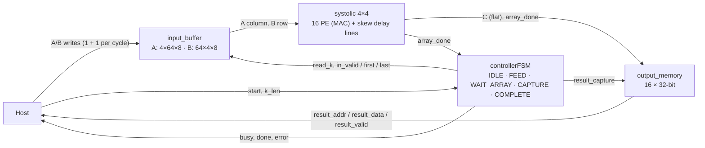
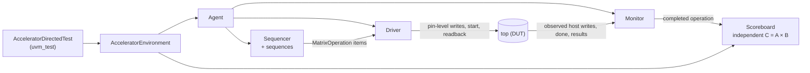

# tiny-ai-accelerator

**UVM verification and PPA exploration of a parameterized INT8 systolic AI accelerator**
*(Personal research project: RTL → verification → synthesis → place & route)*


A small AI accelerator written in SystemVerilog: a buffered, controller-driven **4×4 output-stationary
systolic array** computing `C = A × B` on signed INT8 data with 32-bit accumulation. It is verified
with directed, seeded-random and UVM-style tests (PyUVM + cocotb), and used to study how
**parallelism (array size)** and **numerical precision (INT4 / INT8 / INT16)** affect
Area, Fmax, Power and Throughput.

**Contents:**
[Checkpoints](#-project-checkpoints) ·
[At a glance](#-at-a-glance) ·
[Architecture](#-architecture) ·
[Verification](#-verification) ·
[Measured results](#-measured-results-rtl-simulation) ·
[Synthesis & PPA](#-synthesis-and-ppa) ·
[Reproduce](#-reproduce) ·
[Limitations and next steps](#-limitations-and-next-steps)

---

## ✅ Project checkpoints


| # | Checkpoint | Status | Evidence in this repo |
|---|---|:---:|---|
| **CP1** | Deploy the accelerator and verify it works | ✅ **DONE** | `testbench/cocotb/accelerator_test.py` (K=3 signed matmul) |
| **CP2** | Complete the unfinished parts: output memory, input buffers, controller FSM, top | ✅ **DONE** | `rtl/output_memory.sv`, `rtl/input_buffer.sv`, `rtl/controllerFSM.sv`, `rtl/top.sv` |
| **CP3** | Verify the unfinished parts | ✅ **DONE** | `tb_input_buffer`, `tb_controllerFSM`, `tb_output_memory`, `tb_top` all PASS |
| **CP4** | UVM verification identification | ✅ **DONE** | `testbench/pyuvm/TODO.md` (verification plan and checklist) |
| **CP5** | Write and verify UVM tests (PyUVM + cocotb) | ✅ **DONE** | `testbench/pyuvm/`, log in `results/logs/pyuvm_regression.log` |
| **CP6** | Deploy on GitHub with README and results folder | ✅ **DONE** | this README, `results/plots/`, `results/data/`, `results/logs/` |
| **CP7** | PnR and physical design to GDS (OpenROAD) | 🟡 **PENDING** | `physical_design/` is still empty; this is the next milestone |

> [!IMPORTANT]
> **Overall progress: 86 % (6 of 7 checkpoints).** The functional and verification work is complete.
> **Next checkpoint: CP7**, the OpenROAD flow from floorplan through routing to a GDS.

---

## 📌 At a glance

| Parameter | Value |
|---|---|
| Array | **4 × 4** output-stationary systolic array (16 PEs), parameterized `ROWS`, `COLS`, `IN_W`, `ACC_W`, `K_MAX`, `SAT` |
| Data type | signed **INT8** inputs, signed **32-bit** accumulators (optional saturation) |
| Inner dimension | **K = 1 … 64**; K = 0 and K > 64 are rejected with `error` |
| Compute latency | **K + R + C = K + 8 clock cycles** from `start` to `done` (measured for every K = 1…64) |
| Peak array throughput | **16 MAC / cycle** (R × C) |
| Achieved compute utilization | **89 %** of peak at K = 64 (14.2 MAC / cycle) |
| Host interface | 1 A element + 1 B element written per cycle; 16 result words read back |
| Largest result observed | 1,048,576 (= (−128)² × 64), no overflow in 32 bits |
| Functional mismatches | **0** over 7,440 result words in the characterization runs |
| Regression | **13 / 13** module testbenches + PyUVM suite + cocotb baseline: **PASS** |
| Synthesis (generic gates, `top`) | 22,917 cells, 5,540 flip-flops |
| Pre-P&R PPA (sky130, 4×4 INT8) | 84,136 µm², 114 MHz Fmax, 3.6 peak GOPS |

---

## 🧱 Architecture



| Block | File | Role |
|---|---|---|
| `top` | `rtl/top.sv` | Integration; gates host writes while `busy` |
| `input_buffer` | `rtl/input_buffer.sv` | Holds all A and B elements for one operation; one K-slice read per cycle |
| `controllerFSM` | `rtl/controllerFSM.sv` | Validates K, sequences feed / wait / capture, drives `busy`, `done`, `error` |
| `systolic` | `rtl/systolic.sv` | R×C PE grid; A flows right, B flows down; inputs skewed by row / column |
| `pe` / `mac` | `rtl/pe.sv`, `rtl/mac.sv` | Processing element and INT8 multiply-accumulate (optional saturation) |
| `output_memory` | `rtl/output_memory.sv` | Captures all 16 results in parallel; results are hidden while `busy` |

Supporting arithmetic studies live in `rtl/adders/` (ripple-carry, block CLA, Kogge-Stone) and
`rtl/mac_pipe.sv`, `rtl/mac_csa.sv` (see [Arithmetic studies](#-arithmetic-studies)).

---

## 🧪 Verification

Verification is layered: self-checking unit testbenches, a block-level systolic testbench, a top-level
cocotb baseline, and a PyUVM environment with an independent scoreboard.


### Regression summary

| Layer | Test | Checks | Result |
|---|---|---:|:---:|
| Unit | `tb_fa` | 8 | ✅ PASS |
| Unit | `tb_rca` (N = 8) | 20,006 | ✅ PASS |
| Unit | `tb_cla` (N = 8) | 20,006 | ✅ PASS |
| Unit | `tb_cla4` | 256 | ✅ PASS |
| Unit | `tb_ks` (N = 8) | 20,006 | ✅ PASS |
| Unit | `tb_mac` | 7,060 | ✅ PASS |
| Unit | `tb_mac_pipe` | 20,000 | ✅ PASS |
| Unit | `tb_mac_csa` | 40,001 | ✅ PASS |
| Unit | `tb_input_buffer` | 52 | ✅ PASS |
| Unit | `tb_controllerFSM` (K = 1, 3, 64; invalid K = 0, 65) | scenarios | ✅ PASS |
| Unit | `tb_output_memory` (two matrices, signed reads, busy gating, reset) | scenarios | ✅ PASS |
| Block | `tb_systolic` 4×4 (204 matrices) | 3,264 | ✅ PASS |
| System | `tb_top` (K = 1, 3, 64; invalid K; reset recovery) | scenarios | ✅ PASS |
| System | cocotb baseline `accelerator_test.py` (K = 3) | 16 words | ✅ PASS |
| System | **PyUVM suite** `test_accelerator_uvm.py` | 7 operations × 16 words | ✅ PASS |

### PyUVM environment



| Component | File | Responsibility |
|---|---|---|
| Transaction | `matrix_item.py` | `MatrixOperation` (K, A, B) and `InvalidKOperation`, with validation |
| Sequences / sequencer | `Sequencer.py` | `SingleOperationSequence`, `InvalidKSequence`, `BusyWriteIgnoredSequence` |
| Driver | `Driver.py` | Loads A/B, pulses `start`, waits for `done`, reads results; checks invalid-K behavior |
| Monitor | `monitor.py` | Observes host writes, completion and result reads |
| Scoreboard | `scoreboard.py` | Recomputes `C = A × B` independently, compares all 16 words, tracks coverage |
| Environment / agent | `environment.py`, `agent.py` | Assembles and connects the components |
| Test | `test_accelerator_uvm.py` | Directed scenarios plus seeded random operations |

### Scenarios covered (all passing)

| Scenario | What it proves |
|---|---|
| K = 1 boundary | Smallest legal operation produces correct results |
| K = 64 boundary | Largest legal operation; full-depth buffers and K counter (last index 63) |
| Busy-write rejection | Writes to A/B during `busy` are ignored; result stays unchanged |
| Invalid K = 0 and K = 65 | `error` asserts for one cycle, DUT stays idle, no valid result is produced |
| Reset recovery | A valid K = 2 operation succeeds after reset |
| Signed INT8 corners | Operands include −128, 127, −1 and 0 |
| Seeded random (seed `20261115`) | 3 reproducible random operations; the seed is logged for exact replay |
| Checker confidence | A deliberate +1 bias on expected `C[0][0]` made the run fail with coordinate, actual, expected and mismatch count; probe removed afterwards (recorded in `testbench/pyuvm/TODO.md`) |

**Coverage reported by the scoreboard:** K values `[1, 2, 3, 4, 64]`, data classes
`[negative, positive, zero]`, signed corners `[-128, 127]`.

---

## 📈 Measured results (RTL simulation)

All numbers in this section come from `testbench/characterize/` (cocotb + Icarus) and are exported to
`results/data/`. Clock is 10 ns (100 MHz) in simulation; cycle counts are clock-independent.

### Compute latency is exactly K + 8


Latency was measured for **every** legal K = 1…64 and equals `K + R + C` each time:
**K** cycles to feed the array, **R + C − 1 = 7** cycles in `WAIT_ARRAY` while the skewed data drains through the grid, and
**1** capture cycle. `done` pulses on the following cycle.

### Controller timing


### Throughput and utilization


| K | MACs | Host load (cycles) | Compute (cycles) | Readout (cycles) | Compute MAC/cycle | End-to-end MAC/cycle |
|--:|--:|--:|--:|--:|--:|--:|
| 1 | 16 | 4 | 9 | 16 | 1.78 (11 %) | 0.55 (3 %) |
| 4 | 64 | 16 | 12 | 16 | 5.33 (33 %) | 1.45 (9 %) |
| 8 | 128 | 32 | 16 | 16 | 8.00 (50 %) | 2.00 (12 %) |
| 16 | 256 | 64 | 24 | 16 | 10.67 (67 %) | 2.46 (15 %) |
| 32 | 512 | 128 | 40 | 16 | 12.80 (80 %) | 2.78 (17 %) |
| 64 | 1024 | 256 | 72 | 16 | **14.22 (89 %)** | **2.98 (19 %)** |

> [!NOTE]
> **Key finding: the host interface, not the array, limits end-to-end throughput.**
> The array reaches 89 % of its 16 MAC/cycle peak at K = 64, but loading A and B at one element of each
> per cycle takes `4K` cycles against `K + 8` cycles of compute, so end-to-end utilization saturates near
> 19 %. Wider or double-buffered input loading (overlapping the next load with the current compute) is
> the highest-leverage architectural change.

### Stress and robustness

| Test | Operations | Result words compared | Mismatches |
|---|--:|--:|--:|
| Full K sweep (K = 1…64, random data) | 64 | 1,024 | **0** |
| Random stress (random K, uniform INT8) | 300 | 4,800 | **0** |
| Worst-case magnitude (INT8 extremes only, incl. (−128)² × 64) | 101 | 1,616 | **0** |
| Invalid K = 0, 65, 100, 127 | 4 | n/a | `error` asserted, `busy` stayed low, `error` cleared next cycle (4 of 4) |

---

## 🔧 Synthesis and PPA

### Area breakdown of the integrated design


| Block | Generic cells | Share | Flip-flops | Share |
|---|--:|--:|--:|--:|
| Systolic array (16 PE + skew) | 12,469 | 54.4 % | 915 | 16.5 % |
| Input buffers (A + B) | 8,780 | 38.3 % | 4,096 | 73.9 % |
| Output memory | 1,566 | 6.8 % | 513 | 9.3 % |
| Controller FSM | 99 | 0.4 % | 16 | 0.3 % |
| Top glue | 3 | 0.0 % | 0 | 0.0 % |
| **Total** | **22,917** | | **5,540** | |

*Yosys `synth` + ABC (generic AND/NAND/OR/NOR/XOR/XNOR/MUX), hierarchical, with instance cells
rolled up per block. Raw reports: `results/logs/synth_top_hier_stat.txt`.*

> [!NOTE]
> **Storage dominates the flip-flop count.** The A/B input buffers hold 4,096 bits (K_MAX = 64) and account
> for 74 % of all flip-flops and 38 % of cells, while the compute array is only 17 % of the flip-flops.
> `K_MAX` is therefore the main area knob of the buffered design.

### PPA vs. array size (INT8, ACC_W = 32)


Pre-P&R estimate of the `systolic` array: Yosys + ABC timing-driven mapping to `sky130_fd_sc_hd`
(tt, 25 °C, 1.8 V), no wire load, 500 ps assumed for clock-to-q + setup.

| array | IN_W | ACC_W | cells | FFs | area (µm²) | µm²/PE | fmax (MHz) | delay (ps) | peak GOPS |
|---|---|---|---|---|---|---|---|---|---|
| 2x2 | 8 | 32 | 2421 | 183 | 20563 | 5141 | 115 | 8192 | 0.9 |
| 4x4 | 8 | 32 | 9843 | 819 | 84136 | 5258 | 114 | 8252 | 3.6 |
| 8x8 | 8 | 32 | 39374 | 3435 | 341107 | 5330 | 117 | 8060 | 15.0 |
| 16x16 | 8 | 32 | 160343 | 14043 | 1376809 | 5378 | 113 | 8349 | 57.9 |

Area grows with the number of PEs (area per PE stays flat) while Fmax does not depend on array size: the
critical path (`a*b + acc`) lies inside one PE and PEs only talk to their neighbours, so throughput scales
with R×C at a constant clock.

### PPA vs. precision (4×4, ACC_W = 2·IN_W + 16)


| array | IN_W | ACC_W | cells | FFs | area (µm²) | µm²/PE | fmax (MHz) | delay (ps) | peak GOPS |
|---|---|---|---|---|---|---|---|---|---|
| 4x4 | 4 | 24 | 4278 | 547 | 39329 | 2458 | 159 | 5771 | 5.1 |
| 4x4 | 8 | 32 | 9843 | 819 | 84136 | 5258 | 114 | 8252 | 3.6 |
| 4x4 | 16 | 48 | 28864 | 1363 | 231618 | 14476 | 72 | 13433 | 2.3 |

Peak throughput per area: **INT4 ≈ 130**, **INT8 ≈ 43**, **INT16 ≈ 10** GOPS/mm². Halving the operand width
roughly halves PE area (the multiplier scales with IN_W²) and shortens the critical path, so low precision
wins twice.

### 🧮 Arithmetic studies


**Adders: logic depth (gate levels, as written) vs. width** (`scripts/adder_depth.sh`)

| N | ripple-carry | block CLA (4-bit) | Kogge-Stone |
|---|---|---|---|
| 8  | 15  | 8  | 7  |
| 16 | 31  | 12 | 9  |
| 32 | 63  | 20 | 11 |
| 64 | 127 | 36 | 13 |
| cells @ 64 | 317 | 596 | 1091 |

Ripple-carry is 2N−1, Kogge-Stone 2·log₂N+1. With the generic gate set and no delay target, ABC optimizes for
area and rewrites the fast adders into slower ones (Kogge-Stone N=64: 13 → 97 levels), which is why synthesis
needs a timing constraint, not only a fast architecture.

**MAC accumulation loop** (generic gates after ABC)

| design | stages | longest stage (levels) | cells |
|---|---|---|---|
| `mac` | 1 | 59 | 719 |
| `mac_pipe` | 2 | 52 (accumulate) vs. 30 (multiply) | 749 |
| `mac_csa` | 2 | 7 (carry-save loop) | 910 |

The feedback loop `acc → adder → acc` cannot be pipelined. Keeping the accumulator in carry-save form leaves
one full-adder level in the loop and moves the carry-propagate add to the output, where it is needed once per
dot product.

**MAC cell count vs. precision** (Yosys, generic gates, ACC_W = 32): IN_W 4 → 384, 8 → 719, 16 → 2019 cells.
The multiplier grows roughly with IN_W².

---

## 🔁 Reproduce

```bash
# --- module testbenches (Icarus) -------------------------------------------
make sim TOP=top                          # integrated accelerator
make sim TOP=systolic P="ROWS=4 COLS=4"   # C = A x B vs. reference model
make sim-vl TOP=systolic                  # Verilator
make lint TOP=systolic                    # Verilator -Wall lint
make synth TOP=top                        # Yosys generic synthesis + cell counts

# --- cocotb / PyUVM (python venv with: pip install cocotb pyuvm) ------------
python testbench/cocotb/run.py            # direct cocotb baseline (K = 3)
cd testbench/pyuvm && make sim PYTHON=python   # PyUVM suite (directed + seeded random)

# --- characterization + plots ----------------------------------------------
python testbench/characterize/run.py      # -> results/data/measurements.json
python scripts/make_plots.py              # -> results/plots/*.png, results/data/*.csv

# --- PPA (needs the sky130 PDK under $PDK_ROOT, default ~/pdk) --------------
scripts/ppa_sky130.sh systolic ROWS=8 COLS=8
scripts/systolic_sweep.sh                 # size and precision PPA tables
scripts/adder_depth.sh ks                 # adder logic depth vs. width
```

`TOP` selects the design (default `mac`); the testbench is `testbench/tb_<TOP>.sv`.

### Repository layout

```
rtl/                  synthesizable SystemVerilog (top, controller, buffers, systolic, PE/MAC, adders)
testbench/            self-checking SV testbenches (tb_*.sv)
  cocotb/             direct cocotb baseline
  pyuvm/              PyUVM environment: item, sequences, driver, monitor, scoreboard, env, test
  characterize/       K-sweep, stress and timing-trace measurements (feeds the plots)
synthesis/            Yosys scripts / constraints
physical_design/      OpenROAD flow configs (CP7, pending)
scripts/              PPA sweeps, adder depth, make_plots.py
results/
  plots/              committed figures used in this README
  data/               CSV / JSON behind every figure
  logs/               regression and synthesis reports
docs/notes/           study notes
```

### Status by design stage

| Stage | Block | Status |
|---|---|---|
| 1 | INT8 MAC unit (`rtl/mac.sv`), optional saturation | ✅ RTL + self-checking TB (Icarus + Verilator) |
| 1a | Pipelined MAC (`mac_pipe`), carry-save accumulating MAC (`mac_csa`) | ✅ verified against `mac` |
| 1b | Adder study: ripple-carry, block CLA, Kogge-Stone (`rtl/adders/`) | ✅ exhaustive / random TBs, depth sweep |
| 2 | Processing Element (`rtl/pe.sv`) | ✅ |
| 3 | 2×2 systolic array | ✅ |
| 4 | Parameterized R×C array (`rtl/systolic.sv`) | ✅ verified 2×2 … 8×8, non-square, wrap/saturate |
| 5 | Input / weight buffers (`rtl/input_buffer.sv`) | ✅ RTL + TB |
| 6 | Controller FSM (`rtl/controllerFSM.sv`), output memory, top | ✅ RTL + TB + system tests |
| 6a | PyUVM + cocotb verification environment | ✅ directed + seeded random, scoreboard, coverage |
| 7 | Logic synthesis (Yosys → sky130 HD) | 🟡 pre-P&R area / delay estimates (array); generic-gate breakdown (top) |
| 8 | Place & Route (OpenROAD) → GDS | ⏳ **next (CP7)** |
| 9 | PPA sweeps (size × precision) | 🟡 pre-P&R sweep done |

---

## ⚠️ Limitations and next steps

- **CP7: OpenROAD place & route to GDS is not done.** All PPA numbers above are pre-P&R estimates with no wire
  load. The sky130 sweeps cover the `systolic` array only; the integrated `top` (with its 4,096-bit buffers) has
  so far only a generic-gate breakdown, not sky130 area or Fmax.
- **Host loading is the throughput bottleneck** (19 % end-to-end vs. 89 % compute utilization at K = 64). Overlapping
  load and compute is the biggest improvement available.
- **PyUVM random coverage is thin.** The 3 seeded random operations drew only K = 3, 1, 64. The characterization
  sweep covers every K = 1…64 outside the UVM environment; folding a K sweep into the UVM test would close that gap.
- **Functional coverage is tracked by hand** in the scoreboard (sets of K values, data classes and corners),
  not with covergroups.
- Power is not yet estimated; it needs post-P&R switching activity.
